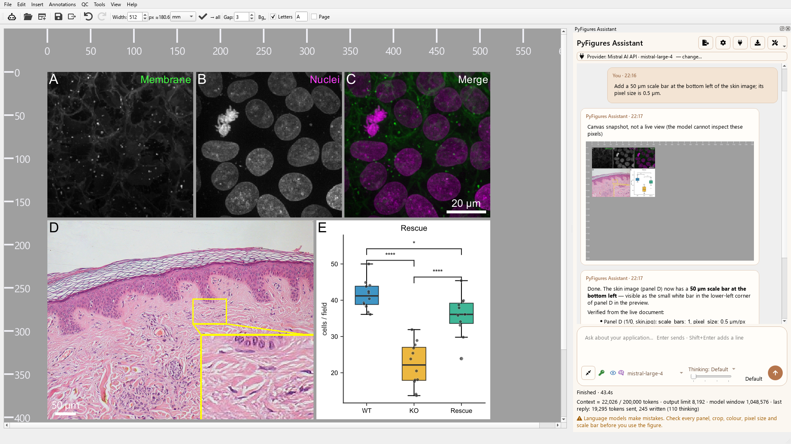

# PyFigures

Effortless creation of high-quality scientific figures in Python. 

[](https://youtu.be/sq7d1Aon4cQ)

Since a video is better than a thousand (click on the image above to view the demo). Or click here to access the complete [demo playlist](https://www.youtube.com/playlist?list=PLCtF2DKlhKYd6oz6qZPgA_WrD025q5Bl7).

**Note**: Most demo images are public domain and sourced from the [Cell Image Library](http://www.cellimagelibrary.org/).

# AI / MCP Integration

PyFigures ships an **MCP server** that lets AI assistants (Claude Code, Claude Desktop,
LM Studio with local models, and any other MCP-compatible client) read and edit `.pyf`
figure files through natural language.

➜ See **[docs/MCP_SERVER.md](docs/MCP_SERVER.md)** for setup instructions and a full tool reference.

# Poster / collage designer

Alongside the main figure editor, PyFigures includes a separate **Poster /
collage designer** (`Tools > Poster / collage designer…`) for posters and
decorative photo-album pages: images can be freely rotated without being
cropped, dragged anywhere with smart alignment guides, and placed over a
full-page background image. It's a distinct tool with its own `.pyfposter`
file format — it doesn't touch or share files with the scientific figure
editor. Photo albums (front cover, two-page spreads, back cover) have their own
**Photo album designer** (`Tools > Photo album designer…`, or
`python -m pyfigures.album`).

➜ See **[docs/poster.md](docs/poster.md)** for the full guide.

# Installation

## 1. Conda Installation (Advanced Users)

For advanced users, we recommend installing the software using Conda. This will offer unlimited scripting capabilities.

### Prerequisites

- Install [Miniconda](https://docs.anaconda.com/miniconda/) if it is not already installed on your system.

### Installation Steps

Perform the following steps **only once** to set up your environment:

1. **Open a Command Prompt or Terminal.**

   - To open a **command prompt** on **Windows**, press **Windows+R** then type **cmd**.
   - To open a **command prompt** on **MacOS**, press **Command+Space** then type **Terminal**.
   - To open a **command prompt** on **Ubuntu**, press **Ctrl+Alt+T**.


2. **Create and activate a new Conda environment:**
   
    ```sh
    conda create -y -n PyFigures python==3.10.12
    conda activate PyFigures
    ```

3. **Upgrade pip:**
    
    ```sh
    pip install -U pip
    ```

4. **Install the `pyfigures` package:**
    
    ```sh
    pip install -U pyfigures
    ```

5. **Optional: Install openjdk8 if you plan to use bioformats**
    
    ```sh
    pip install install-jdk
    python -c "import os; import jdk; jdk_path = os.path.join(os.path.expanduser('~'), '.jdk/jdk8'); jre_path = os.path.join(os.path.expanduser('~'), '.jre/jdk8'); os.makedirs(jdk_path, exist_ok=True); os.makedirs(jre_path, exist_ok=True); jdk.install('8', path=jdk_path); jdk.install('8', path=jre_path, jre=True)"
    ```
    
   **Note:** this step needs to be done **only once**, if you already did it you can skip this step.

   
6. **Optional: Install additional dependencies for bioformats support:**
    
    ```sh
    pip install -U pyfigures[bioformats]
    ```
    
    This installs [pyimagej](https://pypi.org/project/pyimagej/), which opens microscopy formats (.czi, .nd2, .lif, ...) through Fiji / Bio-Formats. To get every optional feature at once (Bio-Formats, video and the MCP server), use `pip install -U pyfigures[all]` instead.
    

7. **Optional: Install video support (reading movies, exporting H.264 videos):**
    
    ```sh
    pip install -U pyfigures[video]
    ```
    
    This installs [PyAV](https://pyav.org) (`av`), which ships its own copy of ffmpeg for Windows, macOS and Linux — there is nothing else to install, no system ffmpeg is needed.
    
    Video support is optional, so a plain `pip install pyfigures` does not include it:
    - **Without PyAV**, PyFigures reads movies only if OpenCV (`opencv-python`) happens to be installed, and exports videos with OpenCV's old MPEG-4 codec, which **QuickTime, Safari and PowerPoint on a Mac cannot play** (a warning says so).
    - **With PyAV**, `.mp4`, `.mov` and `.mkv` exports are H.264; `.mp4` and `.mov` play everywhere, including QuickTime, Safari, Keynote and PowerPoint on a Mac (QuickTime does not open `.mkv` files, use VLC). `.webm` exports are VP9, for web pages (QuickTime does not open `.webm` either). `.avi` exports stay Motion-JPEG. **For a Mac, choose `.mp4`.**
    - The GUI offers to run `pip install av` for you (once per session) the first time you add a movie or export a video without it. The standalone executables already include it.
    - A movie too long to fit in memory (more than a quarter of the free RAM, at most 4 GB) is loaded keeping every k-th frame; its frame rate is divided by k so time stamps stay right.

### Run
   
   **Note:** The following steps need to be performed **only after** the software has been installed.
   
   Open a command prompt and type:

   ```sh
   conda activate PyFigures
   python -m pyfigures
   ```
   
   **Optional**: After running the software, you may deactivate the Conda environment if you wish:

   ```sh
   conda deactivate
   ```

## 2. Standalone Executable Installation (Easy)

Alternatively, you can install the software as a standalone executable. This does not require Conda and can be run on any system without the need for additional dependencies, but scripting capabilities will be limited to the bundled dependencies. 

- Windows **coming soon!** 
- MacOS **coming soon!**
- Linux **coming soon!**

**Supported Macs:** the macOS executables include video support, which needs **macOS 14 (Sonoma) or newer on Apple Silicon** Macs and macOS 11 or newer on Intel Macs. On older Apple Silicon systems the app still opens, but movies cannot be read or exported; older systems are not supported (install with Conda/pip instead, see above).

**First launch on a Mac:** the app is not signed by Apple, so macOS refuses to open it the first time. Go to *System Settings → Privacy & Security* and click **Open Anyway** (needed only once).

# Third party libraries

Below is a list of the 3<sup>rd</sup> party libraries used by PyFigures.<br><br> <font color='red'>**IMPORTANTLY: if you disagree with any license below, <u>please uninstall PyFigures</u>**.<br></font>

| Library name            | Use                                                         | Link                                          | License            |
|-------------------------|-------------------------------------------------------------|-----------------------------------------------|--------------------|
| **Markdown**            | Python implementation of Markdown                           | https://pypi.org/project/Markdown/            | BSD                |
| **matplotlib**          | Plots images and graphs                                     | https://pypi.org/project/matplotlib/          | PSF                |
| **numpy**               | Array/Image computing                                       | https://pypi.org/project/numpy/               | BSD                |
| **Pillow**              | Reads 'basic' images (.bmp, .png, .pnm, ...)                | https://pypi.org/project/Pillow/              | HPND               |
| **PyQt6**               | Graphical user interface (GUI)                              | https://pypi.org/project/PyQt6/               | GPL v3             |
| **QtPy**               | An abstraction layer for PyQt and PySide                    | https://pypi.org/project/QtPy/               | MIT             |
| **read-lif**            | Reads Leica .lif files                                      | https://pypi.org/project/read-lif/            | GPL v3             |
| **czifile**             | Reads Zeiss .czi files                                      | https://pypi.org/project/czifile/             | BSD (BSD-3-Clause) |
| **tifffile**            | Reads .tiff files (also reads Zeiss .lsm files)             | https://pypi.org/project/tifffile/            | BSD                |
| **scikit-image**        | Image processing                                            | https://pypi.org/project/scikit-image/        | BSD (Modified BSD) |
| **scipy**               | Great library to work with numpy arrays                     | https://pypi.org/project/scipy/               | BSD                | 
| **scikit-learn**               | Great library for machine learning                          | https://pypi.org/project/scikit-learn/               | BSD                | 
| **tqdm**                | Command line progress                                       | https://pypi.org/project/tqdm/                | MIT, MPL 2.0       |
| **natsort**             | 'Human' like sorting of strings                             | https://pypi.org/project/natsort/             | MIT                |
| **numexpr**             | Speeds up image math                                        | https://pypi.org/project/numexpr/             | MIT                |
| **urllib3**             | Model architecture and trained models download              | https://pypi.org/project/urllib3/             | MIT                |
| **qtawesome**           | Elegant icons for PyQT/PySide                                       | https://pypi.org/project/QtAwesome/           | MIT                |
| **pandas**              | Data analysis toolkit                                       | https://pypi.org/project/pandas/              | BSD (BSD-3-Clause) |
| **roifile**               | A library to read ImageJ ROIs                               | https://pypi.org/project/roifile/               | BSD 3-Clause                |
| **Qt** (PyQt6-Qt6)      | The Qt libraries under PyQt6                                | https://www.qt.io/                            | LGPL v3            |
| **pyqt6-plugins**       | Qt image-format plugins (TIFF, ...)                         | https://pypi.org/project/pyqt6-plugins/       | GPL v3             |
| **batoolset**           | Image I/O and tools (same author)                           | https://pypi.org/project/batoolset/           | BSD                |
| **elasticdeform**       | Image deformation                                           | https://pypi.org/project/elasticdeform/       | BSD                |
| **imagecodecs**         | Image compression codecs (TIFF, ...)                        | https://pypi.org/project/imagecodecs/         | BSD 3-Clause       |
| **prettytable**         | Text tables                                                 | https://pypi.org/project/prettytable/         | BSD 3-Clause       |
| **pyperclip**           | Clipboard                                                   | https://pypi.org/project/pyperclip/           | BSD                |
| **pyautogui**           | Screen helpers                                              | https://pypi.org/project/PyAutoGUI/           | BSD                |
| **psutil**              | Memory checks                                               | https://pypi.org/project/psutil/              | BSD 3-Clause       |
| **Deprecated**          | Deprecation warnings                                        | https://pypi.org/project/Deprecated/          | MIT                |
| **Requests**            | Downloads                                                   | https://pypi.org/project/requests/            | Apache 2.0         |
| **python-pptx**         | Editable PowerPoint export (with lxml and XlsxWriter)       | https://pypi.org/project/python-pptx/         | MIT                |

Optional (installed only if you ask for them):

| Library name            | Use                                                         | Link                                          | License            |
|-------------------------|-------------------------------------------------------------|-----------------------------------------------|--------------------|
| **PyAV** (`av`, `pyfigures[video]`) | Reads videos, writes H.264 / VP9 videos         | https://pypi.org/project/av/                  | BSD 3-Clause       |
| **FFmpeg** (inside PyAV) | Video codecs; this build includes **x264 and x265** (GPL v2+) and LGPL/BSD codec libraries | https://ffmpeg.org/ | **GPL v3** as built |
| **mcp** (`pyfigures[ai]`) | MCP server                                                | https://pypi.org/project/mcp/                 | MIT                |
| **PyYAML**              | YAML recipes (JSON recipes need nothing)                    | https://pypi.org/project/PyYAML/              | MIT                |
| **opencv-python**       | Alternative video reader                                    | https://pypi.org/project/opencv-python/       | Apache 2.0         |
| **pyimagej / scyjava / JPype** (`pyfigures[bioformats]`) | Fiji / Bio-Formats image reading                     | https://pypi.org/project/pyimagej/            | Apache 2.0 / Unlicense / Apache 2.0 |

### Licence of PyFigures and of the standalone executables

- **PyFigures' own source code is BSD 2-Clause** (see [LICENSE](LICENSE)). Installed with pip, it uses the libraries above under their own licences; note that PyQt6, read-lif and pyqt6-plugins are GPL v3, so if you redistribute PyFigures together with them, that combination falls under the GPL v3.
- **The standalone executables (Windows / macOS) are distributed under the GNU GPL v3** as a whole, because they include PyQt6 and FFmpeg built with x264/x265. Qt is used under the LGPL v3 and is dynamically linked, so it can be replaced. Each executable contains the licence texts of everything inside it (*Help → About → Third-party licences*, or `THIRD_PARTY_LICENSES.txt` next to the Windows executable), and the **complete corresponding source code** of every bundled component is attached to the same GitHub release as the executables (`corresponding-source-*.tar`). This is generated automatically by [`packaging/collect_licenses.py`](packaging/collect_licenses.py) when the executables are built.

# Other Figure-Making Software

[FigureJ](https://imagej.net/plugins/figurej)

[ScientiFig](https://imagej.github.io/list-of-update-sites/)

[omero.figure](https://www.openmicroscopy.org/omero/figure/)

[EzFig](https://imagej.github.io/list-of-update-sites/)

[QuickFigures](https://github.com/grishkam/QuickFigures)