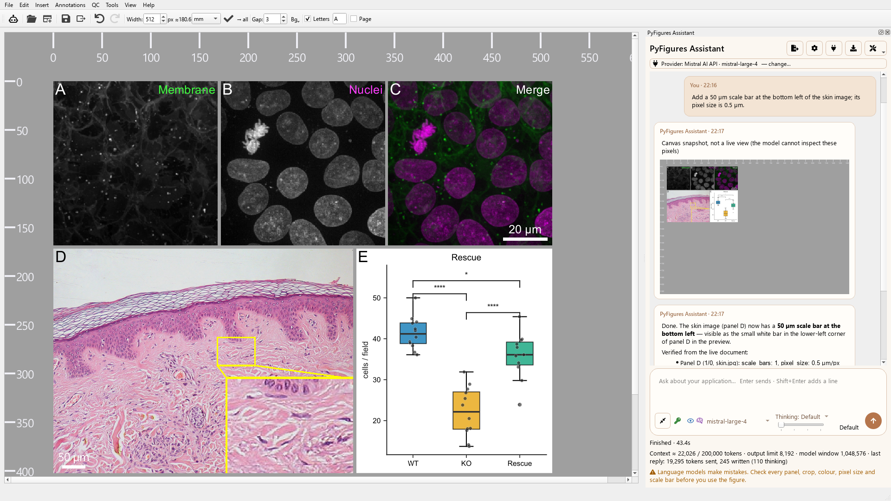

# PyFigures

Effortless creation of high-quality scientific figures in Python. 



*A figure built from a recipe, with the chat sidebar docked on the right: asked in plain words, a language model (here Mistral Large 4) has just added the scale bar to panel D, one undo step. Sample images from scikit-image (public domain, CC0).*

A [demo video](https://youtu.be/sq7d1Aon4cQ) and the complete [demo playlist](https://www.youtube.com/playlist?list=PLCtF2DKlhKYd6oz6qZPgA_WrD025q5Bl7) show the interface at work (recorded with an earlier version; most images in them are public domain, from the [Cell Image Library](http://www.cellimagelibrary.org/)).

# AI / MCP Integration

PyFigures ships an **MCP server** that lets AI assistants (Claude Code, Claude Desktop,
LM Studio with local models, and any other MCP-compatible client) read and edit `.pyf`
figure files through natural language.

➜ See **[docs/MCP_SERVER.md](docs/MCP_SERVER.md)** for setup instructions and a full tool reference.

## Image search

Find your image files by what they show ("confocal gut with DAPI", "western blot",
"brightfield embryo") instead of by file name. Ask the chat sidebar, e.g. *"index my folder
~/data/2024"* and then *"find the gut images stained with DAPI"*: it shows the best matches
as numbered thumbnails and can add the one you pick to the figure. From a terminal:

    python -m pyfigures.image_search index ~/data/2024
    python -m pyfigures.image_search search ~/data/2024 "gut stained with DAPI"

It needs the chat sidebar's optional embeddings: in the chat panel, tools menu >
**Embeddings (optional)…**, choose **Mistral AI API** (uses the Mistral key you already stored
for the chat) or a local server. Each image is described in a few sentences by a vision model
(Mistral: `mistral-small-latest`, the dialog's *Image descriptions* field), then its file name,
folder, size, channels and description are embedded (`mistral-embed`). **Describing sends a
512 px thumbnail of each image to Mistral**; `--describe off` (or `describe="off"` in the chat)
indexes names and metadata only and sends no pixels. With a local server nothing leaves the
computer, and images are described only if that server serves a vision model you name.

The index is kept in the folder (`.pyfigures_image_index/`), covers its subfolders and is
incremental: re-indexing reads only new or changed images. Searching a subfolder uses its
parent's index. Changing the embedding model means indexing again (the descriptions are kept,
only the texts are re-embedded). In the chat, one indexing call works for about 100 s and then
continues on the next call; use the terminal command for folders of thousands of images.

## Demo videos from past chats

**Tools → Make a demo video from a chat…** (also in the chat sidebar's *Procedures* menu)
films part of a chat that already happened, without asking the model again. You choose the
chat, its first and last request, the pacing (about 1 s per step, 3 s on the result, at most
60 s in all by default: a longer film has its steps and answers shortened alike), whether
the model's intermediate messages show, and MP4 (H.264, 1280 px), GIF (8 frames/s, 960 px) or
both. Off-screen, the figure is put back as it was before the first request (from the copy the
chat saved then; if that copy is gone, an earlier one with the requests in between replayed
unseen), then each request is typed in the chat, the model's recorded edits are run again one
by one on the figure and its recorded answers appear; a *Replayed from the chat* label is on
every frame. The timing is not the real one, the images the chat used must still exist, edits
made by hand between requests were not recorded, and exports or saves are not repeated.

    python -m pyfigures.assistant.chat_video CHAT.jsonl --list
    python -m pyfigures.assistant.chat_video CHAT.jsonl --from 2 --to 4 -o demo.mp4 --format both

The chat logs are in `<user data>/qtpy-ai-sidecar/PyFigures/chats`; MCP: `make_chat_video`.

# Poster / collage designer

Alongside the main figure editor, PyFigures includes a separate **Poster /
collage designer** (`Tools > Poster / collage designer…`) for posters and
decorative photo-album pages: images can be freely rotated without being
cropped, dragged anywhere with smart alignment guides, and placed over a
full-page background image. It's a distinct tool with its own `.pyfposter`
file format — it doesn't touch or share files with the scientific figure
editor. Photo albums (front cover, two-page spreads, back cover) have their own
**Photo album designer** (`Tools > Photo album designer…`, or
`python -m pyfigures.album`).

➜ See **[docs/poster.md](docs/poster.md)** for the full guide.

# Installation

## 1. Conda Installation (Advanced Users)

For advanced users, we recommend installing the software using Conda. This will offer unlimited scripting capabilities.

### Prerequisites

- Install [Miniconda](https://docs.anaconda.com/miniconda/) if it is not already installed on your system.

### Installation Steps

Perform the following steps **only once** to set up your environment:

1. **Open a Command Prompt or Terminal.**

   - To open a **command prompt** on **Windows**, press **Windows+R** then type **cmd**.
   - To open a **command prompt** on **MacOS**, press **Command+Space** then type **Terminal**.
   - To open a **command prompt** on **Ubuntu**, press **Ctrl+Alt+T**.


2. **Create and activate a new Conda environment (Python 3.11 recommended):**
   
    ```sh
    conda create -y -n PyFigures python=3.11
    conda activate PyFigures
    ```

    Python 3.10 to 3.13 work, but 3.11 is the tested default; some optional extras need 3.11 or newer (OME-Zarr).

3. **Upgrade pip:**
    
    ```sh
    pip install -U pip
    ```

4. **Install the `pyfigures` package:**
    
    ```sh
    pip install -U pyfigures
    ```

    This includes the chat sidebar, which opens beside the figure at start-up (untick **View → Open the chat at start-up** to stop that). **Without any AI:** install `pyfigures-noai` instead (not both): the same program without the chat sidebar package and with no chat or MCP entries.

    ```sh
    pip install -U pyfigures-noai
    ```

    The standalone apps on the [releases page](https://github.com/baigouy/PyFigures/releases) come in the same two kinds: **PyFigures** (with the chat sidebar) and **PyFigures NoAI**, plus **PyFigures MCP Edition** (the AI is an outside app reaching the figure through MCP).

5. **Optional: Install openjdk8 if you plan to use bioformats**
    
    ```sh
    pip install install-jdk
    python -c "import os; import jdk; jdk_path = os.path.join(os.path.expanduser('~'), '.jdk/jdk8'); jre_path = os.path.join(os.path.expanduser('~'), '.jre/jdk8'); os.makedirs(jdk_path, exist_ok=True); os.makedirs(jre_path, exist_ok=True); jdk.install('8', path=jdk_path); jdk.install('8', path=jre_path, jre=True)"
    ```
    
   **Note:** this step needs to be done **only once**, if you already did it you can skip this step.

   
6. **Optional: Install Fiji support (Bio-Formats microscopy formats):**
    
    ```sh
    pip install -U pyfigures[fiji]
    ```
    
    This installs [pyimagej](https://pypi.org/project/pyimagej/), which opens microscopy formats (.czi, .nd2, .lif, ...) through Fiji / Bio-Formats. To get every optional feature at once (Bio-Formats, video, OME-Zarr and vector PDF panels), use `pip install -U pyfigures[all]` instead. The chat sidebar ([qtpy-ai-sidecar](https://pypi.org/project/qtpy-ai-sidecar/)) and the MCP server are installed by default.
    

7. **Optional: Install video support (reading movies, exporting H.264 videos):**
    
    ```sh
    pip install -U pyfigures[video]
    ```
    
    This installs [PyAV](https://pyav.org) (`av`), which ships its own copy of ffmpeg for Windows, macOS and Linux — there is nothing else to install, no system ffmpeg is needed — and OpenCV (`opencv-python-headless`), which reads `.mp4` / `.avi` / `.mkv` files as image stacks.
    
    Video support is optional, so a plain `pip install pyfigures` does not include it:
    - **Without PyAV**, PyFigures reads movies only if OpenCV (`opencv-python`) happens to be installed, and exports videos with OpenCV's old MPEG-4 codec, which **QuickTime, Safari and PowerPoint on a Mac cannot play** (a warning says so).
    - **With PyAV**, `.mp4`, `.mov` and `.mkv` exports are H.264; `.mp4` and `.mov` play everywhere, including QuickTime, Safari, Keynote and PowerPoint on a Mac (QuickTime does not open `.mkv` files, use VLC). `.webm` exports are VP9, for web pages (QuickTime does not open `.webm` either). `.avi` exports stay Motion-JPEG. **For a Mac, choose `.mp4`.**
    - The GUI offers to run `pip install av` for you (once per session) the first time you add a movie or export a video without it. The standalone executables already include it.
    - A movie too long to fit in memory (more than a quarter of the free RAM, at most 4 GB) is loaded keeping every k-th frame; its frame rate is divided by k so time stamps stay right.

8. **Optional: Install OME-Zarr support (images from OME-Zarr servers or local `.zarr` folders; needs Python 3.11 or newer):**

    ```sh
    pip install -U pyfigures[zarr]
    ```

    Then use *Insert → Add image from URL / OME-Zarr…* (or give the URL to `add_image` / a recipe), e.g. an image from the [IDR](https://idr.openmicroscopy.org/) such as `https://uk1s3.embassy.ebi.ac.uk/idr/zarr/v0.4/idr0062A/6001240.zarr`. The pyramid level, pixel size (for scale bars) and channel colours come from the image; only the chosen level is downloaded. Remote images are read with `requests`, so no extra network library is needed. Plain image URLs (`https://…/image.tif`) work without this extra.

    **OMERO** needs nothing extra: paste an image's OMERO.web link (`https://…/webclient/img_detail/1234/`) in the same dialog, or give it to `add_image` / a recipe. PyFigures reads it through OMERO.web (no omero-py / Ice install), asks for a login on private servers (kept in memory only; scripts and the MCP server use `OMERO_USERNAME` / `OMERO_PASSWORD`), and gets the pixel size and channels from OMERO. Pixels come from OMERO.web's renderer: 256 levels per channel over its data range, exact for 8-bit images and ample for display. The figure stays a desktop file; nothing is stored on the server.

    **Raw 16-bit / float pixels from OMERO (optional):** install omero-py, and once you are logged in the planes are read raw, in the image's own data type, through OMERO's own API (the server's Ice port 4064, `OMERO_HOST` / `OMERO_PORT` if different, or its websocket endpoint). Anything that fails there falls back to OMERO.web. omero-py needs zeroc-ice, which has no PyPI wheel for Windows: on Windows install Glencoe Software's zeroc-ice wheel for your Python first (https://github.com/glencoesoftware/zeroc-ice-py-win-x86_64/releases), then

    ```sh
    pip install -U pyfigures[omero]
    ```

    (Linux and macOS: Glencoe also publishes zeroc-ice wheels; otherwise pip compiles it.) Not included in the standalone apps.

9. **Optional: vector PDF panels (plots made with Matplotlib, pgfplots, gnuplot, R…):**

    ```sh
    pip install -U pyfigures[pdf]
    ```

    A PDF dropped onto the canvas becomes a panel, laid out like an image. For a multi-page PDF you pick the page (like a series in a .lif file; `page:` in recipes, `page=` in `add_image`). Out of the box (and in the standalone apps), the page is rendered with pypdfium2 as a 600 dpi image. With this extra (PyMuPDF, AGPL v3) it stays a **vector panel**, like an SVG file, clipping included, in PDF and SVG exports. The GUI offers to install it for you (one click, downloaded from PyPI only if you accept; also Tools → Vector PDF panels) the first time you add a PDF or export a figure holding PDF panels — in the standalone apps too, where it goes into a per-user folder.

**Plots from tables:**
- **Plots and tables: the full guide is [docs/PLOTS.md](docs/PLOTS.md)** (and Help → ▶ Plots & Tables Tutorial).
- **Data plots with statistics** (bar, box, violin, half violin, split violin, paired before / after with a line per subject, time course lines, scatter, grouped) from a table (CSV, Excel or SQLite), with the test chosen from the data and significance brackets. Change one later without redoing it: another kind, error bars, only the significant brackets, another test (`edit_data_plot`; `list_data_plot_kinds` lists the kinds). Missing or non-numeric cells (empty, NA, a typo) are left out group by group, never filled in, and the chat says what was left out.
- **Seaborn plots, faceted like ggplot2**: any seaborn function (catplot, relplot, displot, lmplot, pairplot, jointplot, heatmap, clustermap, and the axes-level plots) on a tidy CSV, with facets by `col` / `row` (`col_wrap`) as `facet_wrap` / `facet_grid` (`add_seaborn_plot`, `edit_seaborn_plot`, a `seaborn:` recipe panel). The plot re-renders when the CSV changes.
- **Tables can be CSV, TSV, TXT, Excel** (`.xlsx`, `.xlsm`, and old `.xls`) **or an SQLite database** (recognised by its header, whatever its name: pick a table or type an SQL query such as `SELECT genotype, area FROM cells WHERE day = 3`; `sheet=` in the MCP tools and recipes): pick the sheet in the dialog, or `sheet="growth"` (name or number from 1) in the MCP tools and `sheet:` in a recipe; the first sheet otherwise. Blank margin rows and columns are ignored, numbers typed as text in a cell are read as numbers, and semicolon / decimal-comma files (as French or German Excel saves them) are read as such.
- A plot added to the canvas of a figure made of rows gets a row of its own, as wide as the others.
- **Drop a table** (CSV, TSV, Excel, or a .txt holding a table) on the window, alone or with images: the data-plot dialog opens with it. **Drop a .py file** to make it a script panel: it is never run on drop; its code is shown first, with what it does beyond drawing (files deleted or written, programs started, internet), and it runs only if you click *Run as a panel*.
- **Double-click a plot** (or any panel drawn by a script) to open its editor on the *Script* tab.
- Error bars are **SD** by default (as journals ask); SEM, 95 % CI or none on request.
- **The kind of plot is chosen from the data** by default (`kind="auto"`): grouped bars for a two-factor table, a scatter for an x / y series, else by the points per group: bars with every point under 5, a box plot from 5, a violin from 20. The reply says which and why; a tidy table with several factors is said to need a seaborn plot.
- **Plot text looks like the figure's labels**: the font and the size on the printed page of the labels (the texts other than the panel letters, usually smaller than them), followed when they change; 7 pt (journals ask 5-8 pt) when the figure has no labels, whatever the panel's size. Another size or font only when asked (`font_pt`, `font_family`; `"labels"` gives the labels' back).
- **Size and layout of a plot, only when asked**: width / height ratio (`aspect`: "wider", "taller"), size in inches, group order, y range, log y axis, tilted group names, legend inside / outside / none; an axis label removed is gone, not replaced by "Value" (`edit_data_plot`, recipe keys).
- **Half and split violins**: `violin_side="left"` draws half violins with the points beside them; `kind="split_violin"` puts two conditions (e.g. female / male) in the two halves of each violin, with a legend naming them, a test per pair and the two-way ANOVA. Faceted split violins: a seaborn `catplot` with `hue="sex"`, `col="treatment"`, `options={"split": true}`.
- **Plot some columns of a tidy table**: `columns=["genotype", "sex", "area"]` (MCP tools, recipes) takes those columns of a wider sheet, so a table with genotype, treatment, sex, day and area needs no reshaping.
- **Table tools** (pandas): `describe_table` (sheets or tables, each column's type, missing cells, range or levels, the first rows, the plots that fit), `list_factor_columns` (the columns that can split, colour or facet the data, with their levels) and `summarize_table` (n, mean, SD, SEM, median per group, with a `where` filter such as `day == 14`).
- **What people ask of plots**: only some rows (`where="day == 14"`), the colour of parts of a plot (`element_colors={"points": "black", "median": "red"}`), names shown for columns and values (`rename`), titles, facets, cumulative histograms (seaborn `histplot` with `cumulative`, or `ecdfplot`). Axis labels come from the table when none is given (the value column's name on y, the factor on x and as the legend title).
- **Facets with statistics**: `facet="day"` draws one plot per day side by side (a shared y axis), each with its own test; `facet_row="sex"` makes a grid.
- **Comparisons against a control** (`control="WT"`): Dunnett's test after a one-way ANOVA, or Mann-Whitney against it with Bonferroni.
- **Journal details on request**: the n under each group (`show_n`), a mean marker (`show_mean`), the p-values written instead of stars (`p_format="p"`), reference lines (`hlines=[1.0]`).
- **Tables as panels**: a data table, or a summary per group (n, mean ± SD, median [IQR]...), drawn as a live figure panel (`add_table_panel`, a `table:` recipe panel).
- **Lines above a table are skipped** (an instrument's header, a title, notes in an Excel sheet): found automatically and said in the reply, or `skip_rows=3` by hand.
- Colours are colour-blind safe (Wong palette; seaborn's `colorblind`), and points of each series also get their own shape, so they are told apart in grey too.
- Violins taper past the smallest and largest values (2 bandwidths, as seaborn draws them), with the range, quartiles and median inside.
- **Plot settings in the GUI** (right-click a data plot → *Plot settings…*): its kind, error bars, title and y label, violins (whole / half, what is inside), points (shown, jitter / swarm / line), n under the groups, mean markers, p-values instead of stars, a control to compare with, facets and the rows kept — the same changes as `edit_data_plot`.
- **The code of a plot** (right-click → *Show plot code…*, to copy or save as .py; MCP `data_plot_code`): a script that redraws it with staplot, then reads the table with pandas exactly as the plot did and reruns the test with scipy / statsmodels alone, so a reviewer can check every step. The chat sees each plot's settings as this code.
- **Save & Consolidate** copies the tables of plot panels (CSV, Excel) into the `.files` folder with the images, and the plots read the copies; a moved figure finds them again.
- **For the chat**, a plot panel is described by what it draws (its CSV, settings, groups, test and p-values; a script panel by its code), next to its preview image.

**Scale bars:**
- **Each scale bar reads on its own panel**: a new bar, or `bar_color="auto"`, is white on a dark image and black on a bright one, measured on the pixels behind it; visible bars matter more than one colour everywhere. A colour asked for is kept, and the reply names the panels where it is hard to see.

**LaTeX mathematics:**
- **In any label or poster text**, `$…$` is typeset as maths (e.g. `$\Delta F/F_0$`, `$t = 12\,\mathrm{min}$`; `\$` is a literal dollar), on screen and in every export, as vectors. With TeX Live, MiKTeX or MacTeX installed, each formula is typeset by **LaTeX itself** (full LaTeX: `\SI{0.12}{\micro\metre\squared\per\second}`, `\bm`, any amsmath construct) in the **label's own font** when XeLaTeX is there (letters, digits, Greek and units in Arial for an Arial label; symbols from Latin Modern Math; else Latin Modern, sans-serif for sans-serif labels) and kept in an `equations/labels` folder next to the figure, so it opens identically on computers without TeX. Without TeX, Matplotlib's built-in maths is used, in the label's own font. (`PYFIGURES_LABEL_MATH=mathtext` forces the built-in engine.)
- **LaTeX documents as panels**: drop a `.tex` file with a figure, a TikZ / pgfplots picture or a table (or `add_image("plot.tex")`, `image: plot.tex` in a recipe). Its first figure/table environment (else its first TikZ picture, else its body) is compiled with its own preamble, in its own folder (relative `\includegraphics` paths work), cropped, and added as a vector PDF panel; captions are left out. A document with several figures, tables or pictures asks which one (`page=` in `add_image`, `page:` in recipes). When the `.tex` changes, PyFigures offers to recompile on opening; right-click → *Recompile from .tex* does it any time (`update_latex_panels`). A `.tex` file holding only maths becomes an editable equation panel.
- **LaTeX code panels**: *Insert → Add LaTeX code panel…* (or `add_latex_code`, a `tex:` recipe panel): write a TikZ / pgfplots picture, a table or a whole document; it is compiled into a vector panel that stays editable (right-click → *Edit LaTeX code…*). A panel script can be LaTeX code itself, and a Python panel script can call `latex(code)`, e.g. to build a table from data. The compiled PDF is kept next to the figure, so it opens on computers without TeX.
- **Data plots typeset by LaTeX**: tick "Typeset the text with LaTeX" (or `latex=True` in `add_data_plot`, `latex: true` on a `plot:` recipe panel): axis labels, ticks and title in sans-serif LaTeX, so `$D$ (\si{\micro\metre\squared\per\second})` works.
- **Equation panels**: *Insert → Add equation (LaTeX)…* (or `add_equation`, or an `equation:` recipe panel), or drop a `.tex` file. Typeset by Matplotlib with no TeX installation, or, if TeX Live, MiKTeX or MacTeX is installed, with **full LaTeX** ("Full LaTeX" in the dialog, `engine="latex"`): any environment (`align*`, `cases`, `pmatrix`…) and any package (`siunitx`, `physics`, `bm`…), in Latin Modern or in any installed font to match the figure (`font="Arial"`, XeLaTeX). The result is saved as an SVG, so the figure opens anywhere; right-click → *Edit equation…* to change it.
- **No LaTeX on the computer?** *Help → Install LaTeX for PyFigures…* (also offered when a LaTeX feature needs it; MCP `install_latex`; `python -m pyfigures.gui.headless_ops install-latex`) downloads [TinyTeX](https://yihui.org/tinytex/), a small TeX Live (about 75 MB to download, 400 MB on disk), into your user folder, with no administrator rights and without changing the PATH, plus every package PyFigures uses. Packages a `.tex` document needs later are installed automatically. It works in the standalone apps too: TeX is not bundled inside them, it is downloaded only by those who want it.
- **PDF + LaTeX export**: labels are typeset by LaTeX itself, in your document's font.

### Run
   
   **Note:** The following steps need to be performed **only after** the software has been installed.
   
   Open a command prompt and type:

   ```sh
   conda activate PyFigures
   python -m pyfigures
   ```
   
   **Optional**: After running the software, you may deactivate the Conda environment if you wish:

   ```sh
   conda deactivate
   ```

## 2. Standalone Executable Installation (Easy)

Alternatively, you can install the software as a standalone executable. This does not require Conda and can be run on any system without the need for additional dependencies, but scripting capabilities will be limited to the bundled dependencies. 

Download them from the [latest release](https://github.com/baigouy/PyFigures/releases/latest). They are portable: nothing is installed and **no administrator rights are needed**.

- **Windows:** `PyFigures-Windows.zip`. Unzip it anywhere you can write (Documents, Desktop, a USB stick) and run `PyFigures.exe` (also `PyFigures Album.exe` and `PyFigures Poster.exe`). If SmartScreen warns about an unknown publisher, click *More info → Run anyway*. To remove it, delete the folder.
- **macOS:** `PyFigures-macOS-AppleSilicon.dmg` (M1 and newer) or `PyFigures-macOS-Intel.dmg`. Open it and drag the apps to *Applications*, or, without administrator rights, to the *Applications* folder inside your home folder (or any folder).
- **Linux (x86-64):** `PyFigures-Linux-x86_64.AppImage`, one file: make it executable (`chmod +x PyFigures-Linux-x86_64.AppImage`, or *Properties → Allow executing*) and double-click it; `--album` / `--poster` open the photo album / poster designers. If it does not start because FUSE is missing, run it with `--appimage-extract-and-run`, or use `PyFigures-Linux-x86_64.tar.gz` instead: unpack it anywhere and run `PyFigures/PyFigures`. Both need a Linux at least as recent as Ubuntu 22.04 (Debian 12, Fedora 36). The chat saves API keys in the desktop's key store (GNOME Keyring, KWallet).

**Supported Macs:** the macOS executables include video support, which needs **macOS 14 (Sonoma) or newer on Apple Silicon** Macs and macOS 11 or newer on Intel Macs. On older Apple Silicon systems the app still opens, but movies cannot be read or exported; older systems are not supported (install with Conda/pip instead, see above).

**Three kinds of app**, each for Windows, macOS and Linux: **PyFigures MCP Edition** (`PyFigures-MCP-Edition-*`: for working from an AI app you already use, such as Mistral Vibe, Claude, Codex, LM Studio or Hermes Agent; it opens without the chat sidebar, shares the open figure with those apps, and at first launch opens *Tools → MCP server…* to register PyFigures with them in one click each, see [MCP_SERVER.md](docs/MCP_SERVER.md)), **PyFigures** (opens with the AI chat sidebar; untick *View → Open the chat at start-up* to stop that), **PyFigures NoAI** (`PyFigures-NoAI-*`: no AI at all; with the album and poster designers too). From a pip install, `python -m pyfigures --chat` opens with the chat sidebar, `--share` shares the figure with the MCP server and `--web-chat` docks the chat web page.

**First launch on a Mac:** the apps are not signed by Apple, so macOS refuses to open them the first time. Go to *System Settings → Privacy & Security* and click **Open Anyway** (needed only once). On macOS 14 or older, right-click the app → **Open** → **Open** also works.

**If macOS says the app "is damaged and can't be opened"** (or *Open Anyway* does not help), it is not damaged: macOS blocks unsigned apps downloaded from the internet. Remove the download mark in Terminal, with the app's real place and name, then open it again:

```sh
xattr -cr /Applications/PyFigures.app
xattr -cr "/Applications/PyFigures NoAI.app"
xattr -cr "/Applications/PyFigures MCP Edition.app"
```

(Only the line for the app you installed is needed. If you put it in the *Applications* folder of your home folder, write `~/Applications/…` instead.)

# Third party libraries

Below is a list of the 3<sup>rd</sup> party libraries used by PyFigures.<br><br> <font color='red'>**IMPORTANTLY: if you disagree with any license below, <u>please uninstall PyFigures</u>**.<br></font>

| Library name            | Use                                                         | Link                                          | License            |
|-------------------------|-------------------------------------------------------------|-----------------------------------------------|--------------------|
| **Markdown**            | Python implementation of Markdown                           | https://pypi.org/project/Markdown/            | BSD                |
| **PyYAML**              | Reads YAML figure recipes                                   | https://pypi.org/project/PyYAML/              | MIT                |
| **matplotlib**          | Plots images and graphs                                     | https://pypi.org/project/matplotlib/          | PSF                |
| **numpy**               | Array/Image computing                                       | https://pypi.org/project/numpy/               | BSD                |
| **Pillow**              | Reads 'basic' images (.bmp, .png, .pnm, ...)                | https://pypi.org/project/Pillow/              | HPND               |
| **PyQt6**               | Graphical user interface (GUI)                              | https://pypi.org/project/PyQt6/               | GPL v3             |
| **QtPy**               | An abstraction layer for PyQt and PySide                    | https://pypi.org/project/QtPy/               | MIT             |
| **read-lif**            | Reads Leica .lif files                                      | https://pypi.org/project/read-lif/            | GPL v3             |
| **czifile**             | Reads Zeiss .czi files                                      | https://pypi.org/project/czifile/             | BSD (BSD-3-Clause) |
| **tifffile**            | Reads .tiff files (also reads Zeiss .lsm files)             | https://pypi.org/project/tifffile/            | BSD                |
| **scikit-image**        | Image processing                                            | https://pypi.org/project/scikit-image/        | BSD (Modified BSD) |
| **scipy**               | Great library to work with numpy arrays                     | https://pypi.org/project/scipy/               | BSD                | 
| **scikit-learn**               | Great library for machine learning                          | https://pypi.org/project/scikit-learn/               | BSD                | 
| **tqdm**                | Command line progress                                       | https://pypi.org/project/tqdm/                | MIT, MPL 2.0       |
| **natsort**             | 'Human' like sorting of strings                             | https://pypi.org/project/natsort/             | MIT                |
| **numexpr**             | Speeds up image math                                        | https://pypi.org/project/numexpr/             | MIT                |
| **urllib3**             | Model architecture and trained models download              | https://pypi.org/project/urllib3/             | MIT                |
| **qtawesome**           | Elegant icons for PyQT/PySide                                       | https://pypi.org/project/QtAwesome/           | MIT                |
| **pandas**              | Data analysis toolkit                                       | https://pypi.org/project/pandas/              | BSD (BSD-3-Clause) |
| **roifile**               | A library to read ImageJ ROIs                               | https://pypi.org/project/roifile/               | BSD 3-Clause                |
| **Qt** (PyQt6-Qt6)      | The Qt libraries under PyQt6                                | https://www.qt.io/                            | LGPL v3            |
| **staplot**             | Data-plot panels and statistics (same author)               | https://pypi.org/project/staplot/             | BSD                |
| **seaborn**             | Seaborn plot panels, faceted like ggplot2                   | https://pypi.org/project/seaborn/             | BSD (BSD-3-Clause) |
| **openpyxl**            | Plots from Excel .xlsx sheets                               | https://pypi.org/project/openpyxl/            | MIT                |
| **xlrd**                | Plots from old Excel .xls files                             | https://pypi.org/project/xlrd/                | BSD (BSD-3-Clause) |
| **batoolset**           | Image I/O and tools (same author)                           | https://pypi.org/project/batoolset/           | BSD                |
| **qtpy-ai-sidecar** (with keyring, httpx, platformdirs) | Chat sidebar (same author)          | https://pypi.org/project/qtpy-ai-sidecar/     | BSD 2-Clause (keyring MIT, httpx BSD, platformdirs MIT) |
| **batoolset-gui**       | Qt drawing layer of batoolset (same author)                 | https://pypi.org/project/batoolset-gui/       | BSD                |
| **elasticdeform**       | Image deformation (via batoolset, Python < 3.13)            | https://pypi.org/project/elasticdeform/       | BSD                |
| **imagecodecs**         | Image compression codecs (TIFF, ...)                        | https://pypi.org/project/imagecodecs/         | BSD 3-Clause       |
| **prettytable**         | Text tables                                                 | https://pypi.org/project/prettytable/         | BSD 3-Clause       |
| **pyperclip**           | Clipboard                                                   | https://pypi.org/project/pyperclip/           | BSD                |
| **pyautogui**           | Screen helpers                                              | https://pypi.org/project/PyAutoGUI/           | BSD                |
| **psutil**              | Memory checks                                               | https://pypi.org/project/psutil/              | BSD 3-Clause       |
| **Deprecated**          | Deprecation warnings                                        | https://pypi.org/project/Deprecated/          | MIT                |
| **Requests**            | Downloads                                                   | https://pypi.org/project/requests/            | Apache 2.0         |
| **python-pptx**         | Editable PowerPoint export (with lxml and XlsxWriter)       | https://pypi.org/project/python-pptx/         | MIT                |
| **latex2mathml**, **mathml2omml** | Label maths as native PowerPoint equations           | https://pypi.org/project/latex2mathml/        | MIT                |
| **pylatexenc**          | Label maths as Unicode text in the Illustrator export       | https://pypi.org/project/pylatexenc/          | MIT                |
| **pypdfium2** (with PDFium) | PDF files as panels, rendered as images                 | https://pypi.org/project/pypdfium2/           | Apache 2.0 / BSD 3-Clause |

Optional (installed only if you ask for them):

| Library name            | Use                                                         | Link                                          | License            |
|-------------------------|-------------------------------------------------------------|-----------------------------------------------|--------------------|
| **PyAV** (`av`, `pyfigures[video]`) | Reads videos, writes H.264 / VP9 videos         | https://pypi.org/project/av/                  | BSD 3-Clause       |
| **FFmpeg** (inside PyAV) | Video codecs; this build includes **x264 and x265** (GPL v2+) and LGPL/BSD codec libraries | https://ffmpeg.org/ | **GPL v3** as built |
| **mcp**                 | MCP server, and the chat sidebar's MCP client                 | https://pypi.org/project/mcp/                 | MIT                |
| **zarr** (`pyfigures[zarr]`) | OME-Zarr images (with numcodecs)                       | https://pypi.org/project/zarr/                | MIT                |
| **PyMuPDF** (`pyfigures[pdf]`) | PDF files as vector panels (not bundled; the GUI offers to install it) | https://pypi.org/project/PyMuPDF/           | **AGPL v3**        |
| **omero-py** + **zeroc-ice** (`pyfigures[omero]`) | Raw pixels from OMERO servers (not in the standalone apps) | https://pypi.org/project/omero-py/ | GPL v2+ (omero-py) / GPL v2 or commercial (Ice) |
| **PyYAML**              | YAML recipes (JSON recipes need nothing)                    | https://pypi.org/project/PyYAML/              | MIT                |
| **opencv-python(-headless)** (`pyfigures[video]`) | Video files as image stacks, alternative video reader | https://pypi.org/project/opencv-python-headless/ | Apache 2.0 |
| **pyimagej / scyjava / JPype** (`pyfigures[fiji]`) | Fiji / Bio-Formats image reading                     | https://pypi.org/project/pyimagej/            | Apache 2.0 / Unlicense / Apache 2.0 |

### Licence of PyFigures and of the standalone executables

- **PyFigures' own source code is BSD 2-Clause** (see [LICENSE](LICENSE)). Installed with pip, it uses the libraries above under their own licences; note that PyQt6 and read-lif are GPL v3, so if you redistribute PyFigures together with them, that combination falls under the GPL v3.
- **The standalone executables (Windows / macOS / Linux) are distributed under the GNU GPL v3** as a whole, because they include PyQt6 and FFmpeg built with x264/x265. Qt is used under the LGPL v3 and is dynamically linked, so it can be replaced. They read PDFs with pypdfium2 (Apache/BSD); PyMuPDF (AGPL) is not included. Each executable contains the licence texts of everything inside it (*Help → About → Third-party licences*, or `THIRD_PARTY_LICENSES.txt` next to the Windows and Linux executables), and the **complete corresponding source code** of every bundled component is attached to the same GitHub release as the executables (`corresponding-source-*.tar`). This is generated automatically by [`packaging/collect_licenses.py`](packaging/collect_licenses.py) when the executables are built. [docs/LICENSING.md](docs/LICENSING.md) explains the reasoning.

# Other Figure-Making Software

[FigureJ](https://imagej.net/plugins/figurej)

[ScientiFig](https://imagej.github.io/list-of-update-sites/)

[omero.figure](https://www.openmicroscopy.org/omero/figure/)

[EzFig](https://imagej.github.io/list-of-update-sites/)

[QuickFigures](https://github.com/grishkam/QuickFigures)