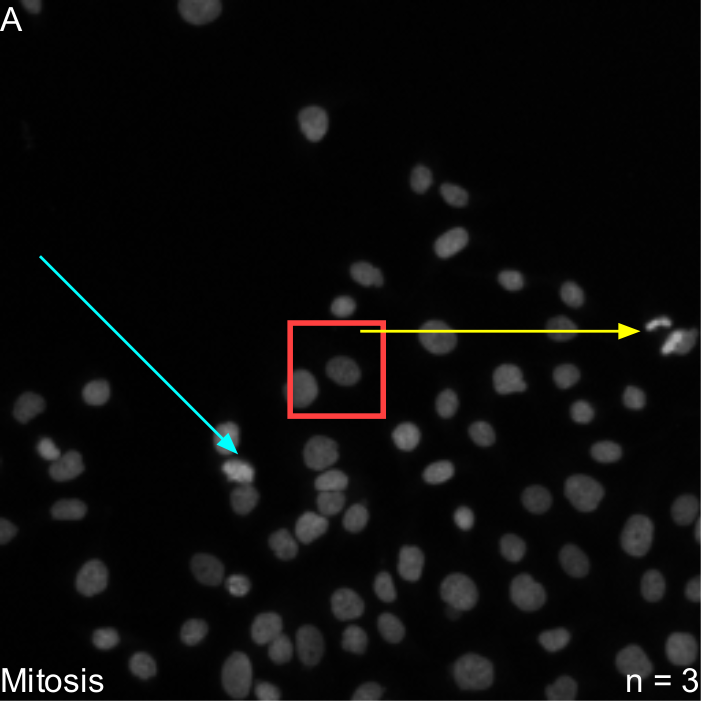

# Arrows, regions and text

Arrows whose tips stay exactly on the cells they point at, outlined regions, and text in the corners.



## Recipe

```yaml
output: figure.pyf
width_mm: 89
rows:
  - - image: ../data/mitosis.png
      crop: {left: 100, right: 156, top: 150, bottom: 106}
      arrows:                      # (x, y) in the image's own pixels
        - {at: [334, 271], from: w, color: yellow}
        - {at: [187, 316], from: nw, color: cyan}
      rois:
        - {rect: [206, 268, 34, 34], color: "#ff4040", stroke: 2}
      text: ["Mitosis", {text: "n = 3", placement: bottom right}]
```

## Run it

- **Command line:** `python -m pyfigures.recipe build recipe.yaml`
- **PyFigures window:** *File → Build figure from recipe…*
- **MCP server:** `build_figure_from_recipe("recipe.yaml")`

Files: [`recipe.yaml`](annotations/recipe.yaml), [`figure.pdf`](annotations/figure.pdf). The data are in [`docs/examples/data/`](https://github.com/baigouy/PyFigures/tree/main/docs/examples/data); paths in the recipe are relative to the recipe.

The result is an ordinary figure: open it in PyFigures to keep editing it by hand.

---

Sample images from [scikit-image](https://scikit-image.org/docs/stable/api/skimage.data.html): `human_mitosis` (nuclei, Moffat et al., Cell 2006), `cells3d` (membrane and nuclei, Allen Institute for Cell Science), `protein_transport` (time-lapse, Boisvert et al.), `skin` (H&E-stained skin). The CSV data are simulated.
