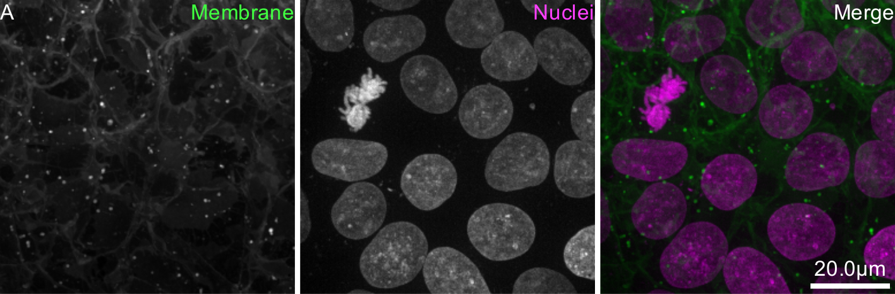

# Channel split and merge

Two channels shown separately in their own colours, then merged, with names on the panels and one scale bar.



## Recipe

```yaml
output: figure.pyf
width_mm: 180
rows:
  - - split: [../data/membrane.tif, ../data/nuclei.tif]
      names: [Membrane, Nuclei]
      colors: [green, magenta]
      merge: true
      px_to_unit: 0.29
      scale_bar: {units: 20, unit: "µm"}
```

## Run it

- **Command line:** `python -m pyfigures.recipe build recipe.yaml`
- **PyFigures window:** *File → Build figure from recipe…*
- **MCP server:** `build_figure_from_recipe("recipe.yaml")`

Files: [`recipe.yaml`](channels/recipe.yaml), [`figure.pdf`](channels/figure.pdf). The data are in [`docs/examples/data/`](https://github.com/baigouy/PyFigures/tree/main/docs/examples/data); paths in the recipe are relative to the recipe.

The result is an ordinary figure: open it in PyFigures to keep editing it by hand.

---

Sample images from [scikit-image](https://scikit-image.org/docs/stable/api/skimage.data.html): `human_mitosis` (nuclei, Moffat et al., Cell 2006), `cells3d` (membrane and nuclei, Allen Institute for Cell Science), `protein_transport` (time-lapse, Boisvert et al.), `skin` (H&E-stained skin). The CSV data are simulated.
