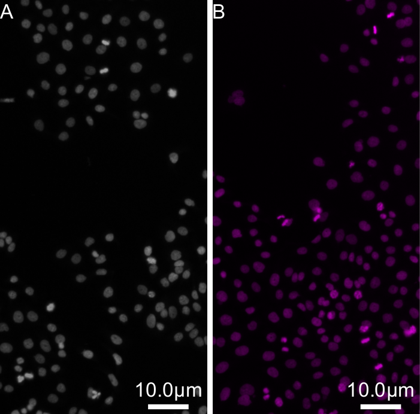
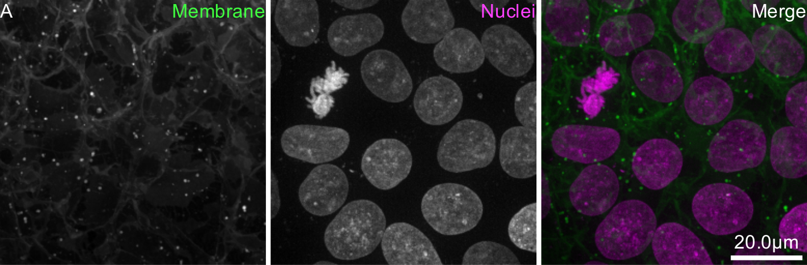
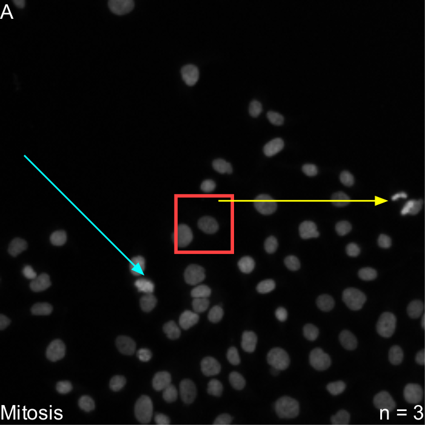
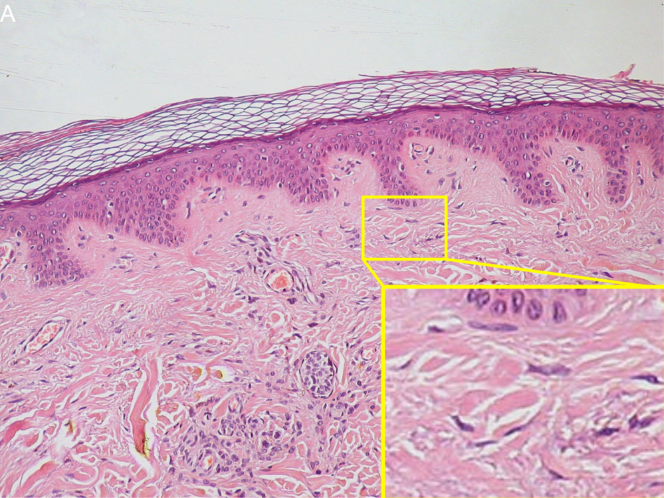
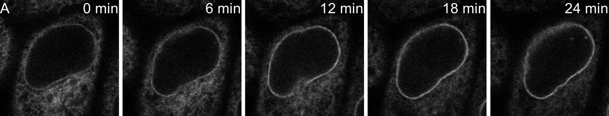
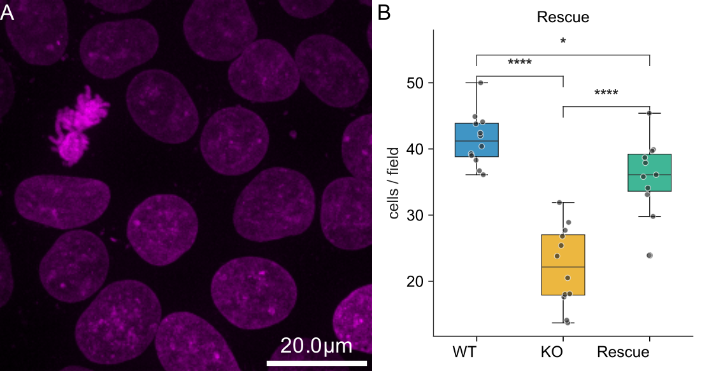
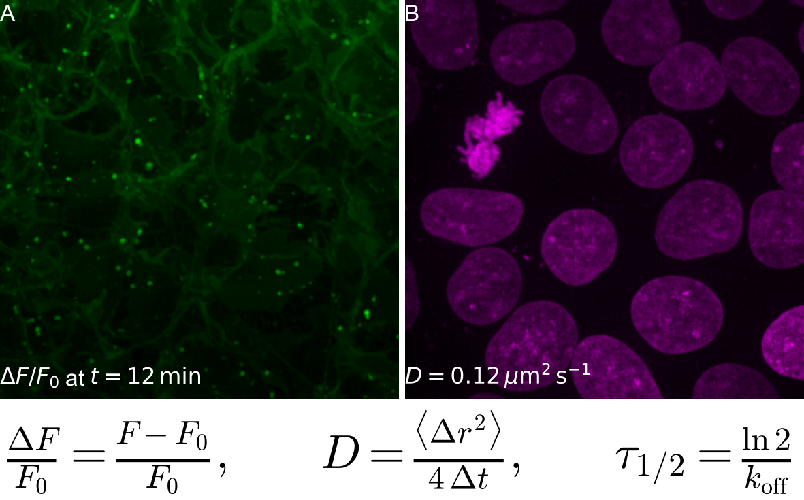
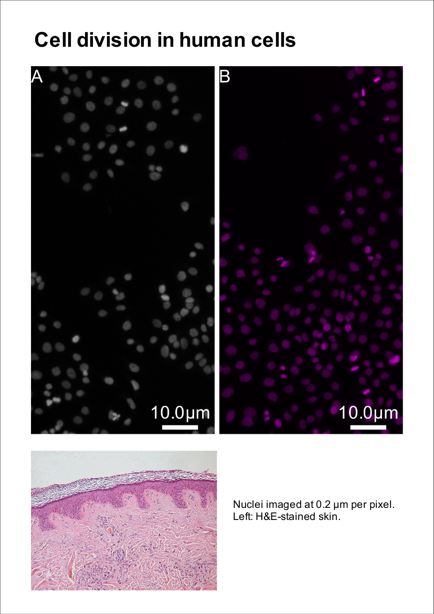

# Examples

Each example is a short recipe (a text file) and the figure PyFigures builds from it. Click one to see its recipe and how to run it. Every feature shown can also be used from the PyFigures window or the MCP server.

<a class="pyf-card" href="basic.html"><b>Micrographs with scale bars and letters</b>Two crops of the same image side by side, lettered A and B, each with a scale bar, sized for a Nature single column.</a>
<a class="pyf-card" href="channels.html"><b>Channel split and merge</b>Two channels shown separately in their own colours, then merged, with names on the panels and one scale bar.</a>
<a class="pyf-card" href="annotations.html"><b>Arrows, regions and text</b>Arrows whose tips stay exactly on the cells they point at, outlined regions, and text in the corners.</a>
<a class="pyf-card" href="zoom.html"><b>Zoom callout</b>A region of a large histology image magnified in a corner, with the box and the leader lines drawn automatically.</a>
<a class="pyf-card" href="timelapse.html"><b>Time-lapse montage with time stamps</b>Five frames of a movie in a row, each stamped with its time.</a>
<a class="pyf-card" href="plot.html"><b>Image and data plot with statistics</b>A micrograph next to a box plot made from a CSV file. The statistical test is chosen automatically (here ANOVA with Tukey's post-hoc test), the significance brackets are drawn, and every p-value is saved with the figure.</a>
<a class="pyf-card" href="latex.html"><b>LaTeX: maths in labels and equation panels</b>Labels can contain LaTeX maths between dollars, and an equation can be a panel of its own (here a row of its own, so it keeps a modest height). Both are vector in every export. Here the equation uses Matplotlib's built-in maths; with engine: latex it is compiled by LaTeX itself (any environment, any package).</a>
<a class="pyf-card" href="poster.html"><b>A poster with a figure on it</b>A poster page with a title, a scientific figure dropped in from its .pyf file (kept vector in PDF/SVG exports, with editable text) and a photo.</a>

---

Sample images from [scikit-image](https://scikit-image.org/docs/stable/api/skimage.data.html): `human_mitosis` (nuclei, Moffat et al., Cell 2006), `cells3d` (membrane and nuclei, Allen Institute for Cell Science), `protein_transport` (time-lapse, Boisvert et al.), `skin` (H&E-stained skin). The CSV data are simulated.
