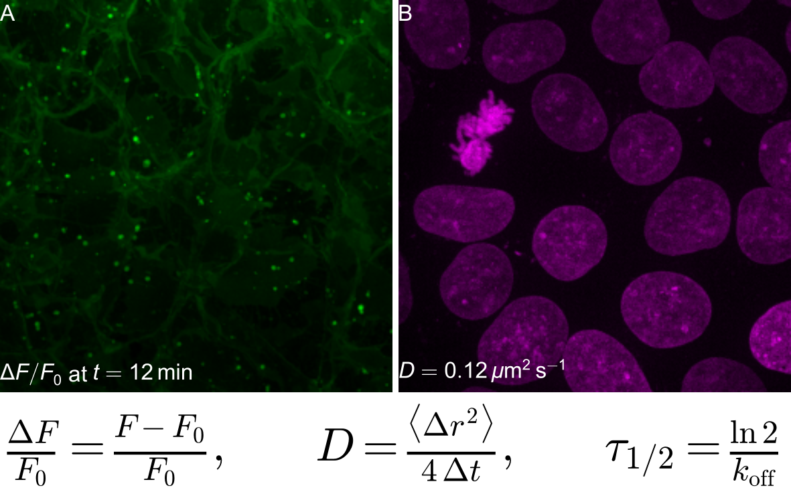

# LaTeX: maths in labels and equation panels

Labels can contain LaTeX maths between dollars, and an equation can be a panel of its own (here a row of its own, so it keeps a modest height). Both are vector in every export. Here the equation uses Matplotlib's built-in maths; with `engine: latex` it is compiled by LaTeX itself (any environment, any package).



## Recipe

```yaml
output: figure.pyf
width_mm: 150
rows:
  - - image: ../data/membrane.tif
      lut: green
      text: ['$\Delta F/F_0$ at $t = 12\,\mathrm{min}$']
    - image: ../data/nuclei.tif
      lut: magenta
      text: ['$D = 0.12\,\mu\mathrm{m}^2\,\mathrm{s}^{-1}$']
  - - equation: '\frac{\Delta F}{F_0} = \frac{F - F_0}{F_0}, \qquad D = \frac{\langle \Delta r^2 \rangle}{4\,\Delta t}, \qquad \tau_{1/2} = \frac{\ln 2}{k_\mathrm{off}}'
      font_size: 12
```

## Run it

- **Command line:** `python -m pyfigures.recipe build recipe.yaml`
- **PyFigures window:** *File → Build figure from recipe…*
- **MCP server:** `build_figure_from_recipe("recipe.yaml")`

Files: [`recipe.yaml`](latex/recipe.yaml), [`figure.pdf`](latex/figure.pdf). The data are in [`docs/examples/data/`](https://github.com/baigouy/PyFigures/tree/main/docs/examples/data); paths in the recipe are relative to the recipe.

The result is an ordinary figure: open it in PyFigures to keep editing it by hand.

---

Sample images from [scikit-image](https://scikit-image.org/docs/stable/api/skimage.data.html): `human_mitosis` (nuclei, Moffat et al., Cell 2006), `cells3d` (membrane and nuclei, Allen Institute for Cell Science), `protein_transport` (time-lapse, Boisvert et al.), `skin` (H&E-stained skin). The CSV data are simulated.
