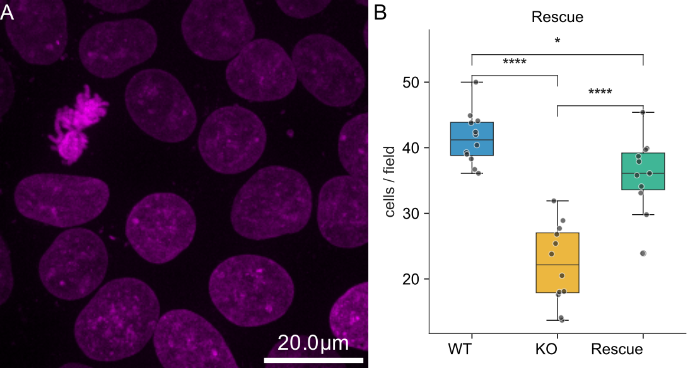

# Image and data plot with statistics

A micrograph next to a box plot made from a CSV file. The statistical test is chosen automatically (here ANOVA with Tukey's post-hoc test), the significance brackets are drawn, and every p-value is saved with the figure.



## Recipe

```yaml
output: figure.pyf
width_mm: 140
rows:
  - - {image: ../data/nuclei.tif, lut: magenta, px_to_unit: 0.29,
       scale_bar: {units: 20, unit: "µm"}}
    - {plot: ../data/counts.csv, kind: box, ylabel: "cells / field", title: "Rescue"}
```

## Run it

- **Command line:** `python -m pyfigures.recipe build recipe.yaml`
- **PyFigures window:** *File → Build figure from recipe…*
- **MCP server:** `build_figure_from_recipe("recipe.yaml")`

Files: [`recipe.yaml`](plot/recipe.yaml), [`figure.pyf`](plot/figure.pyf), [`figure.pdf`](plot/figure.pdf). The data are in [`docs/examples/data/`](https://github.com/baigouy/PyFigures/tree/main/docs/examples/data); paths in the recipe are relative to the recipe.

The result is an ordinary figure: open it in PyFigures to keep editing it by hand.

---

Sample images from [scikit-image](https://scikit-image.org/docs/stable/api/skimage.data.html): `human_mitosis` (nuclei, Moffat et al., Cell 2006), `cells3d` (membrane and nuclei, Allen Institute for Cell Science), `protein_transport` (time-lapse, Boisvert et al.), `skin` (H&E-stained skin). The CSV data are simulated.
