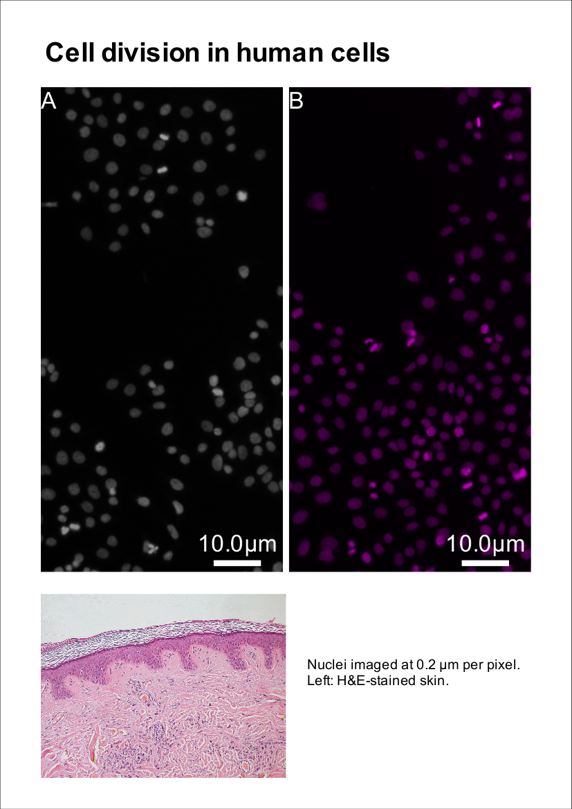

# A poster with a figure on it

A poster page with a title, a scientific figure dropped in from its `.pyf` file (kept vector in PDF/SVG exports, with editable text) and a photo.



## Recipe

```yaml
output: poster.pyfposter
page: A4
render: poster.png
render_dpi: 100
images:
  - {image: ../basic/figure.pyf, x_mm: 15, y_mm: 32, width_mm: 180}
  - {image: ../data/skin.jpg, x_mm: 15, y_mm: 218, width_mm: 90}
text:
  - {html: "<b>Cell division in human cells</b>", style: h1, x_mm: 15, y_mm: 12}
  - {html: "Nuclei imaged at 0.2 µm per pixel.<br>Left: H&amp;E-stained skin.",
     style: body, x_mm: 112, y_mm: 240, width_mm: 80}
```

## Run it

- **Command line:** `python -m pyfigures.poster.poster_headless build recipe.yaml`
- **Poster designer:** *Build from recipe…* on the toolbar
- **MCP server:** `build_poster_from_recipe("recipe.yaml")`

Files: [`recipe.yaml`](poster/recipe.yaml). The data are in [`docs/examples/data/`](https://github.com/baigouy/PyFigures/tree/main/docs/examples/data); paths in the recipe are relative to the recipe.

The result is an ordinary figure: open it in PyFigures to keep editing it by hand.

---

Sample images from [scikit-image](https://scikit-image.org/docs/stable/api/skimage.data.html): `human_mitosis` (nuclei, Moffat et al., Cell 2006), `cells3d` (membrane and nuclei, Allen Institute for Cell Science), `protein_transport` (time-lapse, Boisvert et al.), `skin` (H&E-stained skin). The CSV data are simulated.
